<h1>Hi, I'm Antoine 👋</h1>
 

<i>Computer science student and aspiring data scientist</i>

  <picture><source media="(prefers-color-scheme: dark)" srcset="assets/dark/intro.svg" /></picture>

 
I'm a French engineering student building my way through **Data Science, Machine Learning & Applied AI**
 
> 📍 Based in : Paris, FR
 
> 👨‍🎓 MSc in Data Science & AI @ École Polytechnique, French _Grandes Écoles_
 
> 🏢 Société Générale Credit Portfolio Management (2027) | Revolut Product Data Science (2026) 

---

## Projects

### Research

<a href="https://github.com/Antoinechss/Performer-attention-LLM"><picture><source media="(prefers-color-scheme: dark)" srcset="assets/dark/performer-attention-llm.svg" />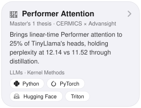</picture></a>
<a href="https://github.com/Antoinechss/Deep-RL-for-traffic-control"><picture><source media="(prefers-color-scheme: dark)" srcset="assets/dark/deep-rl-for-traffic-control.svg" />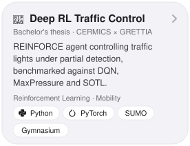</picture></a>
<a href="https://github.com/Antoinechss/NeurIPS2026-emg2pose"><picture><source media="(prefers-color-scheme: dark)" srcset="assets/dark/neurips2026-emg2pose.svg" />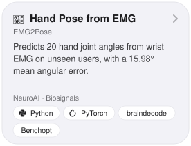</picture></a>

### Data Projects

<a href="https://github.com/Antoinechss/Polymarket-coalition-detection"><picture><source media="(prefers-color-scheme: dark)" srcset="assets/dark/polymarket-coalition-detection.svg" />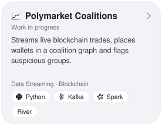</picture></a>
<a href="https://github.com/Antoinechss/geopolitical-conflict-analyzer"><picture><source media="(prefers-color-scheme: dark)" srcset="assets/dark/geopolitical-conflict-analyzer.svg" />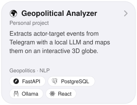</picture></a>
<a href="https://github.com/Antoinechss/EELISA-data-analysis-dataset"><picture><source media="(prefers-color-scheme: dark)" srcset="assets/dark/eelisa-data-analysis-dataset.svg" />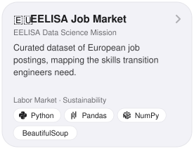</picture></a>

### Optimization & Hackathons

<a href="https://github.com/Antoinechss/Warehouse-optimization"><picture><source media="(prefers-color-scheme: dark)" srcset="assets/dark/warehouse-optimization.svg" />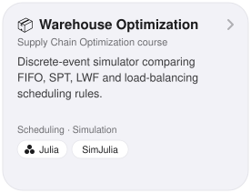</picture></a>
<a href="https://github.com/Antoinechss/OR-Hackathon-by-Califrais"><picture><source media="(prefers-color-scheme: dark)" srcset="assets/dark/or-hackathon-by-califrais.svg" />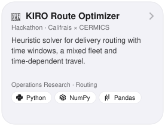</picture></a>
<a href="https://github.com/Antoinechss/Hackathon-ElevenStrategy"><picture><source media="(prefers-color-scheme: dark)" srcset="assets/dark/hackathon-elevenstrategy.svg" />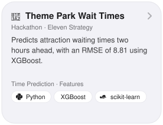</picture></a>

### Personal & Leisure

<a href="https://github.com/Antoinechss/desktop-robot-companion"><picture><source media="(prefers-color-scheme: dark)" srcset="assets/dark/desktop-robot-companion.svg" />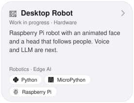</picture></a>
<a href="https://github.com/Antoinechss/Recipe-Recommender-App"><picture><source media="(prefers-color-scheme: dark)" srcset="assets/dark/recipe-recommender-app.svg" />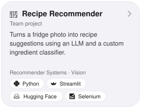</picture></a>
<a href="https://github.com/Antoinechss/Idle-Car-Factory"><picture><source media="(prefers-color-scheme: dark)" srcset="assets/dark/idle-car-factory.svg" />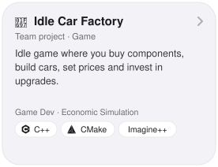</picture></a>

